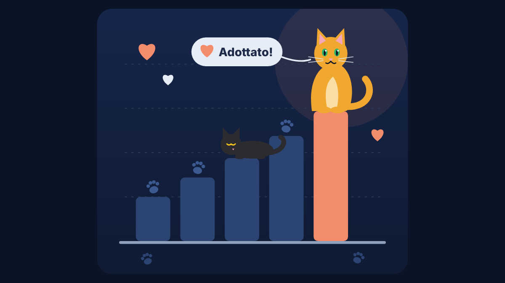
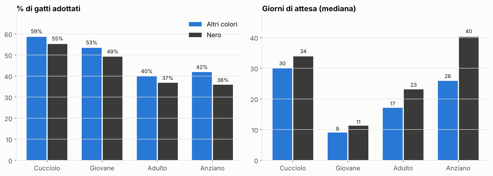
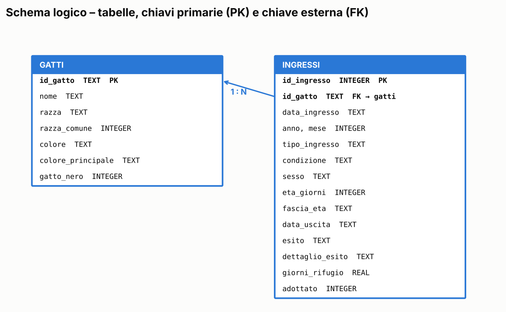

# 🐱 Gatti in rifugio: chi viene adottato prima?



Progetto personale di **Francesco Autorino** – Data Analyst.

🛠️ Strumenti: **SQL · Python · Power BI**

📊 Dati: **69.313 ingressi** di **66.239 gatti** nel rifugio **Austin Animal Center** (Texas), da ottobre 2013 a maggio 2025.

💙 Amo i gatti: per questo ho scelto questo progetto.

---

## 🧭 1. Il progetto in breve

❓ **La domanda**: quali gatti vengono adottati, e quanto aspettano nel rifugio?

Le 5 domande più piccole:

1️⃣ 🚪 Come escono i gatti dal rifugio?

2️⃣ 🍼 L'età conta?

3️⃣ 🐈‍⬛ I gatti neri vengono adottati meno?

4️⃣ 🌸 Ci sono mesi con più gattini e più adozioni?

5️⃣ 🏥 Il modo in cui arriva il gatto conta?

---

## 🎯 2. I risultati principali

✅ **51,7%** dei gatti viene adottato. Il **38,4%** va in un altro rifugio.

⏱️ Prima dell'adozione si aspettano **25 giorni** (mediana).

⚡ I più veloci sono i **giovani (6-12 mesi)**: **9 giorni**.

🍼 I **cuccioli** sono i più adottati (**58%**), ma aspettano **30 giorni**: devono crescere.

🐈‍⬛ I **gatti neri** vengono adottati **3-6 punti in meno** in ogni età, e aspettano di più.
Gli anziani neri: **40 giorni** contro 26. I test dicono che non è un caso.

🌸 A **maggio** entrano **2,5 volte** i gatti di gennaio. Le adozioni arrivano a **luglio e agosto**.

📈 Gatti adottati: dal **37% (2014)** al **64% (2024)**.

🏠 Un gatto **ceduto dal padrone** viene adottato molto di più (**72%**) di un **randagio** (**47%**).

📝 Tutti i dettagli in **02Python/02_CONCLUSIONI.md**.



---

## 🛠️ 3. Perché questi strumenti

🗄️ **SQL**: i dati stanno in 2 tabelle collegate (gatti e ingressi). Con SQL rispondo alle domande con 11 query.

🐍 **Python**: unisco ingressi e uscite, calcolo i giorni nel rifugio, faccio i grafici e i test statistici.

📊 **Dashboard**: dashboard interattiva con filtri nella cartella `03PowerBi` (progetto Power BI in zip e PDF).

---

## 🔄 4. Il percorso dei dati

```
Open Data Austin      01_scarica.py        02_pulizia.py            ANALISI
2 file CSV ─────────► ❌ 1GrezziNonPuliti ──► ✅ 2Puliti ──────────┬──► 🗄️ SQL
(ingressi e uscite)    (173.812 + 173.775    gatti_ingressi.csv   ├──► 🐍 Python
                        righe, tutti         (69.313 righe)       └──► 📊 Power BI
                        gli animali)
```

🧹 **Cosa ho fatto durante la pulizia**

| Passo | Cosa |
|---|---|
| 1 | Tenuti solo i **gatti**: 69.324 ingressi e 69.399 uscite |
| 2 | Tolte **23 righe doppie** |
| 3 | Date trasformate in un formato unico (ingressi e uscite le scrivono in modo diverso) |
| 4 | Età trasformata in giorni ("2 months" → 60) e divisa in 4 fasce |
| 5 | ⭐ Ogni ingresso **unito alla sua uscita**: la prima uscita dello stesso gatto dopo l'ingresso |
| 6 | Se il gatto rientra prima di quell'uscita, l'uscita va al rientro (**21 casi** corretti) |
| 7 | Calcolati i **giorni nel rifugio**: 0 valori negativi |
| 8 | Esiti, tipi di ingresso e condizioni tradotti in italiano |
| 9 | Creati colore principale, "gatto nero" e "razza comune" |

📌 Il risultato di ogni passo è in `02Dati/2Puliti/registro_pulizia.csv`.

---

## 📁 5. I file in questo repository

| Cartella | File |
|---|---|
| 📂 `01SQL` | `00_LEGGIMI.md` · `01_schema_concettuale.png` · `02_schema_logico.png` · `03_crea_database.sql` · `04_query_analisi.sql` |
| 📂 `02Python` | `00_LEGGIMI.md` · `01_analisi_gatti.ipynb` · `02_CONCLUSIONI.md` · `grafici/` (6 grafici) |
| 📂 `03PowerBi` | `00_LEGGIMI.md` · `01_GattiRifugioDashboard.zip` · `02_GattiRifugio_Dashboard.pdf` · `03_misure_DAX.txt` |
| 📂 `Immagini` | `copertina.png` |



### 📦 Dati e script

📥 I dati si riscaricano gratis dalla fonte (link nella sezione 7).

🛠️ Gli script di raccolta, pulizia e creazione del database sono disponibili su richiesta.

---

## ⚠️ 6. I limiti

📌 È **un solo rifugio**, in Texas: i risultati possono essere diversi in Italia.

📌 Non sappiamo **perché** un gatto viene scelto: foto, carattere, salute, prezzo.

📌 Per i **trasferiti** non sappiamo se poi sono stati adottati.

📌 L'età all'ingresso a volte è **stimata** dal rifugio.

📌 Il colore è scritto dal personale: "Black" vuol dire tutto nero, ma qualche errore è possibile.

📌 Il 2025 è solo fino a maggio: nei confronti tra anni lo escludo.

---

## 🔗 7. Da dove arrivano i dati

🏛️ **Austin Animal Center** – portale Open Data della città di Austin (Texas).

| Dataset | Link |
|---|---|
| Ingressi (Intakes) | https://data.austintexas.gov/Health-and-Community-Services/Austin-Animal-Center-Intakes-10-01-2013-to-05-05-2/wter-evkm |
| Uscite (Outcomes) | https://data.austintexas.gov/Health-and-Community-Services/Austin-Animal-Center-Outcomes-10-01-2013-to-05-05-/9t4d-g238 |

📅 Dati scaricati il **17 novembre 2026**.

📜 Dati pubblici, liberi da usare.

---

## 🪜 8. Tutti i passaggi fatti, in ordine

1. 💡 Scelta della domanda: quali gatti vengono adottati e quanto aspettano.
2. 📥 Download dei 2 file dal portale open data di Austin.
3. 🔍 Controllo dei file: colonne, date, tipi di animali.
4. 🧹 Pulizia: solo gatti, doppioni, date, età, traduzioni.
5. 🔗 Unione di ogni ingresso con la sua uscita e calcolo dei giorni nel rifugio.
6. 🗄️ Database SQLite con 2 tabelle, schemi E-R e logico.
7. 🔍 11 query SQL, una o più per ogni domanda.
8. 🐍 Notebook Python: 6 grafici, test chi-quadro e Mann-Whitney.
9. 📝 Conclusioni e consigli per il rifugio.
10. 📊 Dati e misure DAX pronti per Power BI.
11. 🖥️ Dashboard interattiva e guida per Power BI.
11. 🎨 Illustrazione del progetto disegnata da zero.

---
